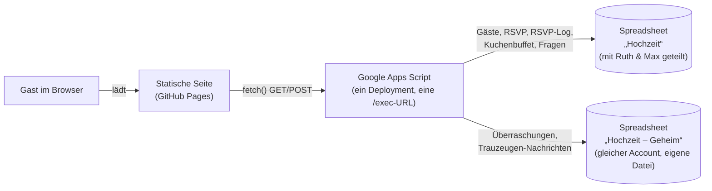
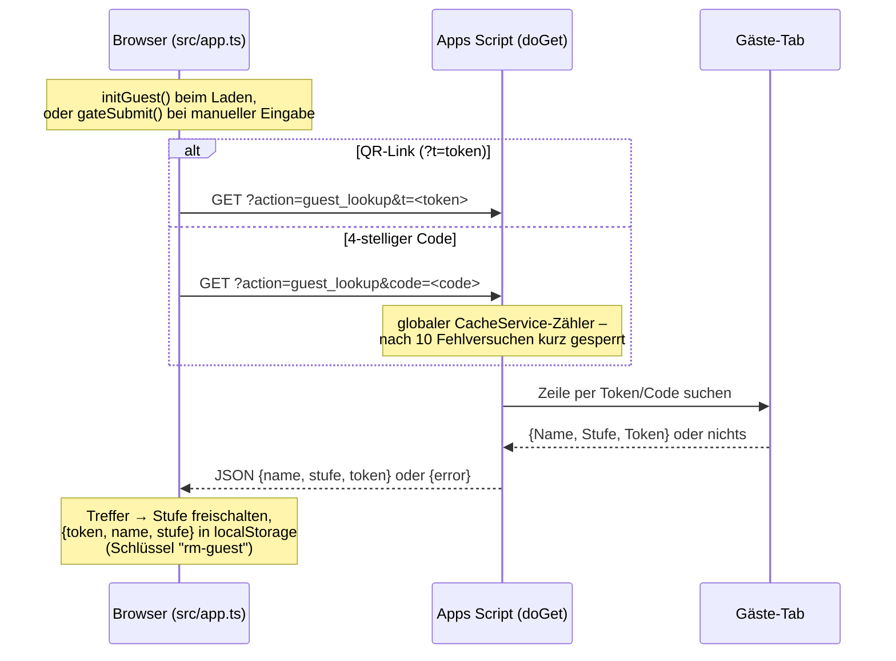
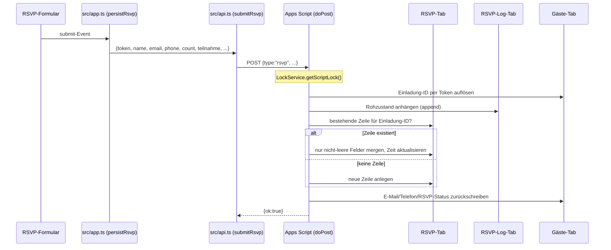
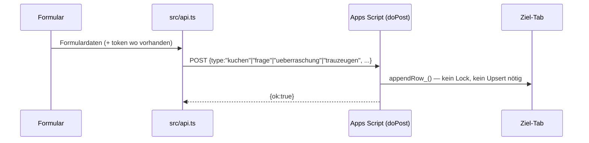

oke # Architektur — Daten & Datenwege

Ergänzt `technical-spec.md` (die geplante Spezifikation) um den tatsächlich
gebauten Stand: welche Daten wo liegen und wie sie dorthin kommen. Bei
Widersprüchen zwischen den beiden Dokumenten gilt dieses hier — es
beschreibt den Code, nicht die Planung.

## Überblick

Die Seite selbst hat kein Backend — jede Interaktion, die etwas
speichert, geht über genau eine Apps-Script-`/exec`-URL
(`public/config/config.json` → `appsScriptUrl`). Das Script öffnet zwei
Spreadsheet-Dateien über ihre IDs (Script Properties
`HOCHZEIT_SHEET_ID`/`HOCHZEIT_GEHEIM_SHEET_ID`), nicht zwei Deployments.

## Datenstrukturen

### `Gäste` (Datei „Hochzeit“, von Ruth & Max vorab gepflegt)

| Spalte | Herkunft | Zweck |
|---|---|---|
| `Einladung-ID` | Menü „Tokens & Codes erzeugen“ | interner Schlüssel, referenziert von `RSVP`/`RSVP-Log`/`Kuchenbuffet` |
| `Name` | manuell | wird bei Token-/Code-Treffer an den Browser zurückgegeben |
| `Stufe` | manuell | `trauung` \| `party` \| `alles` — steuert, was der Gast sieht |
| `Token` | Menü, `Utilities.getUuid()` | im QR-Link (`?t=…`), nicht rate-limitiert (praktisch unerratbar) |
| `Code` | Menü, 4-stellig zufällig | manueller Fallback, hinter globalem Rate-Limit |
| `E-Mail` | Rückschreibung durch RSVP-Submit | informativ, kein Zugriffs-Schlüssel |
| `Telefon` | Rückschreibung durch RSVP-Submit | informativ |
| `RSVP-Status` | Rückschreibung durch RSVP-Submit | letzter `Teilnahme`-Wert, auf einen Blick sichtbar |
| `Notizen` | manuell | frei für Ruth & Max |

Eine Zeile = eine Einladung/ein Haushalt, nicht eine Einzelperson.

### `RSVP` (Datei „Hochzeit“, upserted)

`Zeit, Einladung-ID, Name, E-Mail, Telefon, Anzahl, Teilnahme, Allergien,
Song, Übernachtung, Nachricht, Essenswahl, Liedwunsch,
Übernachtung-Details`

Eine Zeile pro `Einladung-ID`. Merge-only: eine neue Einreichung
überschreibt nur Spalten, für die sie selbst einen Wert mitbringt — ein
leeres Feld lässt den vorherigen Wert stehen. Die letzten drei Spalten
existieren schon, bleiben aber leer, bis Essenswahl/Liedwunsch/Übernachtung
als eigene Formulare gebaut werden.

### `RSVP-Log` (Datei „Hochzeit“, append-only)

Gleiche Spalten wie `RSVP`, aber **eine Zeile pro Einreichung**, nie
bearbeitet. Der Rohzustand bleibt immer erhalten, auch wenn ein Upsert
einmal etwas Unerwartetes tut.

### `Kuchenbuffet` (Datei „Hochzeit“, append-only)

`Zeit, Einladung-ID, Name, Beitrag, Stücke, Art, Kühlung nötig,
vegan/vegetarisch, enthält Nüsse, braucht Kuchenplatte`

Eine Zeile pro Kuchen-Beitrag — eine Person kann mehrere bringen, deshalb
kein Upsert, `Einladung-ID` ist nur Referenz.

### `Fragen` (Datei „Hochzeit“, append-only)

`Zeit, Frage, Kontakt`

### `Überraschungen` (Datei „Hochzeit – Geheim“, append-only)

`Zeit, Von, Kontakt, Idee, Geheim`

### `Trauzeugen-Nachrichten` (Datei „Hochzeit – Geheim“, append-only)

`Zeit, An, Name, Kontakt, Nachricht`

## Datenwege

### 1. Zugriffsgate (Token oder Code → Stufe)

Danach liest jede Formular-Einreichung `guestToken` (Modul-Variable in
`src/app.ts`, aus `localStorage` geladen) und schickt ihn als `token`-Feld
im POST-Body mit — kein Formular muss selbst wissen, welcher Gast gerade
aktiv ist.

### 2. RSVP-Einreichung (Upsert)

Der `LockService`-Block serialisiert das Ganze — ohne ihn könnten zwei
gleichzeitige Einreichungen sich beim „Zeile finden → mergen → schreiben“
überschreiben, weil Sheets selbst nicht transaktional ist.

### 3. Alles andere (Kuchenbuffet, Fragen, Überraschung, Trauzeugen-Nachricht)

Kein Lock nötig, weil ein reines `appendRow_` nie zwei Schreibvorgänge auf
dieselbe Zeile hat — anders als beim RSVP-Upsert gibt es hier nichts, worauf
zwei gleichzeitige Requests kollidieren könnten.

## Wo was im Code lebt

| Was | Datei |
|---|---|
| Sheet-Schema, `doGet`/`doPost`, Upsert-/Lock-/Rate-Limit-Logik | `apps-script/apps-script.gs` |
| HTTP-Client, Payload-Typen | `src/api.ts` |
| Gate-State-Machine, Formular-Handler, `guestToken` | `src/app.ts` |
| Formular-Markup (RSVP/Kuchen/Überraschung/Frage/Trauzeugen) | `src/raw/body.raw.html` |
| Geplantes Zielbild, Begründungen | `technical-spec.md` |
